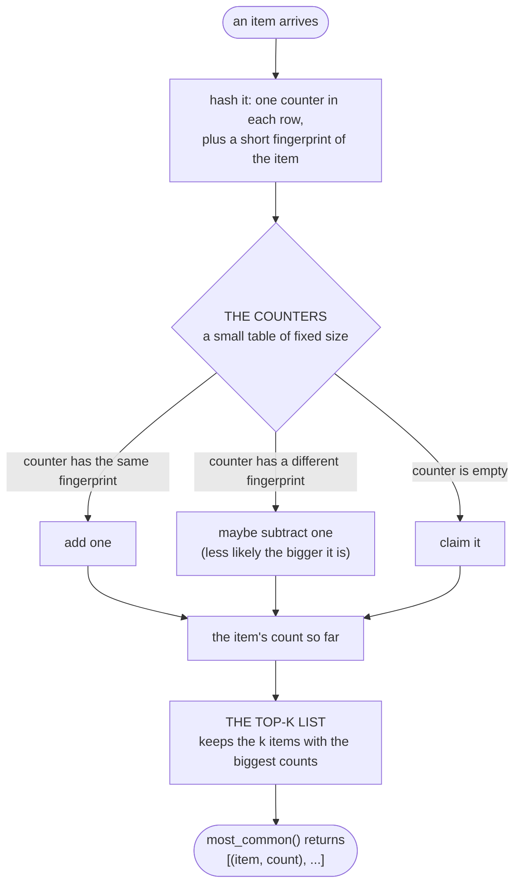

# heavykeeper-topk

[](https://github.com/light-bringer/topk/actions/workflows/ci.yml)

Find the **most frequent items** in a stream of data, using a **small, fixed amount of memory**
however many different items the stream contains. It is a pure-Python implementation of
**HeavyKeeper** (Gong et al., USENIX ATC 2018). No dependencies, works with any hashable key, fully
typed, and the state can be pickled.

> **Status: alpha, not on PyPI yet.** Until the first release, install from source:
> `pip install git+https://github.com/light-bringer/topk`. The package will be called
> `heavykeeper-topk`; you import it as `topk`. Needs Python 3.10 or newer; works on CPython and
> PyPy.

```pycon
>>> from topk import TopK
>>> top = TopK(3, seed=1)  # keep track of the 3 most frequent keys
>>> top.update("banana")  # feed it any iterable of hashable keys, or a {key: count} mapping
>>> top.most_common()
[('a', 3), ('n', 2), ('b', 1)]
>>> top.estimate("a"), "n" in top, len(top), top.total
(3, True, 3, 6)
```

**Contents:** [What it is for](#what-it-is-for) · [How it works](#how-it-works-in-short) ·
[Usage](#usage) · [Choosing parameters](#choosing-parameters) ·
[How accurate is it?](#how-accurate-is-it) · [Other implementations](#other-implementations) ·
[Limitations](#limitations) · [Development](#development)

## What it is for

Counting every item exactly (a `collections.Counter`) needs memory for every *distinct* item. If
the stream holds millions of distinct items, such as client IP addresses, URLs, user IDs or search
terms, and you only care about the busiest few, that is wasteful.

`TopK` answers "what are the `k` most frequent items, and roughly how often did each occur?" using
memory that depends on the settings you choose, not on the length of the stream or the number of
distinct items. Typical uses: the busiest clients in an access log, the most requested URLs, the
hottest keys in a cache, trending terms.

## How it works, in short

HeavyKeeper keeps a small table of counters, each stamped with a short fingerprint of the item that
last used it. When an item arrives it goes to the counters its hash picks. A counter that already
carries the item's fingerprint is increased. A counter carrying a *different* fingerprint is
decreased by one, but only with a probability that shrinks as the counter grows. So a rare item's
counter is quickly worn away by other items, while a frequent item's counter is almost never worn
away. A small separate list remembers which `k` items currently have the biggest counters.



That is the whole idea; [docs/algorithm.md](docs/algorithm.md) explains it step by step with
more diagrams. It gives you:

- **Fixed memory:** about `12 * depth * width` bytes (24.6 KB with the default settings) plus
  roughly 84 bytes per tracked item.
- **Accurate counts for the items that matter:** on a test stream of 500,000 items, the default
  settings found the true top 100 every time, and the reported counts were off by less than 0.1% on
  average (see [How accurate is it?](#how-accurate-is-it)).
- **Counts that are not inflated:** a reported count is never higher than the true count, except
  in the rare case where two different items share a counter *and* have the same fingerprint (see
  the next point).
- **Protection against look-alike items:** two refinements from the paper make it much harder for a
  rare item to borrow a frequent item's count when the two share a counter and a fingerprint. They
  do not rule it out entirely. Given two items in the same counter, their 32-bit fingerprints match
  about once in four billion times; with 8-bit fingerprints, once in 256. With short fingerprints
  the refinements are what keep the results usable (see the benchmarks below).

## Usage

```pycon
>>> from topk import TopK
>>> top = TopK(2, seed=1)
>>> top.add("login", 40)  # count occurrences in bulk (costs O(count), see below)
>>> top.add("search", 25)
>>> top.add("logout")
>>> top.most_common()
[('login', 40), ('search', 25)]
>>> top.most_common(1)
[('login', 40)]
>>> list(top)  # tracked keys, largest first
['login', 'search']
>>> "logout" in top  # seen once, but not among the top 2
False
>>> top.estimate("never-seen")  # no bucket for a key that never appeared
0
```

What you can call:

- `TopK(k, *, width=None, depth=2, decay_base=1.08, fingerprint_bits=32, seed=None,
  key_encoder=None)` creates a tracker for the `k` most frequent keys. See
  [Choosing parameters](#choosing-parameters).
- `add(key, count=1)` counts `count` occurrences of `key`. It costs time proportional to `count`;
  it is a convenience, not a constant-time bulk update.
- `update(items)` counts every key of an iterable, or adds each `key: count` of a mapping, like
  `Counter.update`.
- `most_common(n=None)` returns the tracked `(key, count)` pairs, largest count first (keys with
  equal counts come in no particular order). Pass `n` to get only the first `n`.
- `estimate(key)` asks the sketch what it currently believes `key`'s count is. It is 0 for a key the
  sketch holds nothing for. A rare key outside the top `k` can still show a small count for a while,
  so use `key in top` to ask whether a key is in the top `k`.
- `key in top`, `len(top)` and `iter(top)` give membership in the top `k`, the number of tracked
  keys, and the tracked keys from largest to smallest.
- `top.k`, `top.width`, `top.depth`, `top.decay_base`, `top.seed` and `top.total` are read-only;
  `total` is the number of occurrences counted so far.

A `TopK` is not thread-safe: guard a shared instance with a lock.

### Keys

Keys must be **hashable**. Out of the box, `None`, `bool`, `int`, `str`, `bytes` and tuples of these
work, and so do subclasses such as `IntEnum` or `namedtuple` that do not redefine `==` or `hash`.
For any other key type, pass `key_encoder`: a function from a key to `bytes` that gives equal keys
equal bytes.

```pycon
>>> import struct
>>> def encode_price(price):
...     return struct.pack(">d", price + 0.0)  # "+ 0.0" turns -0.0 into 0.0, as -0.0 == 0.0
>>> top = TopK(2, key_encoder=encode_price, seed=1)
>>> top.update([9.99, 9.99, 4.5, 9.99, 4.5, 0.0, -0.0])
>>> top.most_common()
[(9.99, 3), (4.5, 2)]
>>> top.estimate(0.0), top.estimate(-0.0)  # equal keys share one count
(2, 2)
```

Think about what `==` means for your keys. `-0.0 == 0.0` and `1 == 1.0`, so an encoder built on
`repr()` would split one key's count in two. Ideally different keys also encode differently; if two
happen to share bytes they share counters, which costs some accuracy.

Keys are turned into bytes, rather than passed to Python's `hash()`, because the built-in hash of a
`str` or `bytes` changes from one process to the next, which would make a saved sketch useless. If
you want to pickle the `TopK`, `key_encoder` must be a function defined at module level, not a
lambda. There is a worked example in [docs/examples.md](docs/examples.md).

### Saving state

```pycon
>>> import pickle
>>> top = TopK(2, seed=1)
>>> top.update("aabbbc")
>>> restored = pickle.loads(pickle.dumps(top))
>>> restored.update("bb")
>>> restored.most_common()
[('b', 5), ('a', 2)]
```

A restored instance carries on exactly as an uninterrupted one would. State is guaranteed to load
only with the same release of the library; state from an incompatible version raises `ValueError`.

> **Only unpickle data you trust.** `pickle.loads` can run arbitrary code, and it does so before
> `TopK` gets to check the version, so that check guards against version mismatches, not against
> malicious data. Load checkpoints only from storage you control.

## Choosing parameters

Start with the defaults. If the results look wrong, make `width` larger first.

- **`k`** (required) is how many keys you want. Size the sketch for the *k*-th key, not for the
  most frequent one.
- **`width`** (default `max(1024, 32 * k)`) is the number of counters per row. It is the main
  accuracy and memory setting: wider means more accurate and a little more memory. At the default, a
  500,000-item test stream gave the right top 100 with reported counts off by under 0.1% on average.
  Double it if the *k*-th and the next key are nearly tied.
- **`depth`** (default 2) is the number of rows, each giving a key its own position. The paper uses
  2; more rows cost time for little gain.
- **`decay_base`** (default 1.08, the paper's `b`) controls how readily small counters are worn
  down: a colliding item lowers a counter `C` with probability `b ** -C`. A larger value forgets
  small keys faster. Note that Redis and the `heavykeeper` package use `1 / b` for the same idea.
- **`fingerprint_bits`** (default 32, from 1 to 32) is how long each key's fingerprint is. Shorter
  fingerprints collide more often. Storage is 4 bytes per counter either way, so lowering it saves
  no memory here; the setting exists to study small fingerprints.
- **`seed`** (default random) seeds the hashing and the random decay. Pass an integer for
  reproducible results; `top.seed` tells you the one in use.

**Memory**, measured on CPython 3.13: each counter takes 12 bytes, so the sketch is
`12 * depth * width` bytes (24.6 KB for the defaults of `width=1024`, `depth=2`), and each tracked
key adds about 84 bytes plus the key object itself.

**An error bound, if you want a number.** For a frequent key that holds on to its counter, the
paper's Theorem 3 limits the chance that the estimate falls short of the true count by more than
`epsilon * N` (`N` is the length of the stream) to `1 / (epsilon * width * n * (b - 1))`, where `n`
is the key's true count. For `width = 3200`, `n = 5000`, `b = 1.08`, and a tolerated shortfall of
100 in a stream of 500,000 (so `epsilon = 100 / 500000`):

```pycon
>>> epsilon, width, n, b = 100 / 500_000, 3200, 5000, 1.08
>>> round(1 / (epsilon * width * n * (b - 1)), 4)
0.0039
```

That is under the paper's assumptions (no fingerprint collisions, and a frequent key that keeps its
counter); in practice the measured errors are much smaller.

## How accurate is it?

The tests use a *Zipf* stream: a few keys are very common and most are rare, which is what real
traffic usually looks like. Three numbers describe the result:

- **precision**: the fraction of the true top `k` that were found (1.0 is perfect);
- **ARE**, the average relative error: how far, on average, a reported count is from the true count,
  as a fraction of the true count (0.01 means 1% off);
- **AAE**, the average absolute error: the same, as a plain number of occurrences.

A stream of 500,000 items (skew 1.1, 100,000 possible keys), `k = 100`, on CPython 3.13, one
machine:

| Configuration | precision | ARE | AAE |
|---|---|---|---|
| defaults (32-bit fingerprints, `width = 32k`), five seeds | 1.000 | 0.0005 to 0.0008 | 0.3 to 0.5 |
| 8-bit fingerprints, `width = 8k`: this library | 0.99 to 1.00 | about 0.005 | about 3 |
| 8-bit fingerprints, `width = 8k`: without the two refinements | 0.75 to 0.82 | 385 to 800 | hundreds |

With 32-bit fingerprints, two keys that share a counter almost never also share a fingerprint, so
in these tests the two refinements never came into play and both variants gave identical results.
With 8-bit fingerprints it happens often, and the refinements are the difference between a usable
result and a useless one. That is why they are included.

**Speed.** About 0.3 million inserts per second on CPython 3.13. The Rust-backed
[`heavykeeper`](https://pypi.org/project/heavykeeper/) package is roughly 20 times faster at similar
accuracy; it accepts `str` keys only and implements the basic algorithm without the refinements. A
compiled backend for this library is planned.

To reproduce these numbers from a source checkout (`pip install -e . --group dev`):

```console
$ python -m benchmarks.accuracy --fingerprint-bits 8 32 --with-heavykeeper   # accuracy table
$ python -m benchmarks.throughput                                            # inserts per second
$ pytest -m slow                                                             # accuracy checks, ~15 s
$ pytest -m bench --benchmark-only                                           # microbenchmarks
```

## Differences from the paper

You can skip this section unless you have read the paper. The implementation follows its
Algorithm 1 with both refinements (the paper calls them Optimization I and II) and departs from it
in a few deliberate ways:

1. **Optimization II compares `c <= n_min`**, as the authors' code does. The paper prints
   `C < n_min`; with that strict comparison a newcomer's counter would stall one short of the value
   it needs, so a new frequent key could never enter a full set. (`n_min` is the smallest count in
   the top-k set.)
2. `n_min` is 0 until the top-k set is full, as in the authors' code.
3. Empty counters are handled explicitly. Read literally, the pseudocode would decrement an empty
   counter to -1.
4. A key whose estimate is 0 is never admitted to the set.
5. The decay probability is exactly `b ** -C`; the authors' code uses `1 / floor(b ** C)`.
6. Fingerprints are 32 bits by default (the paper used 16); 1 to 32 are accepted.
7. Hashing is keyed BLAKE2b with double hashing over a canonical encoding of the key, so counter
   positions survive pickling. (The authors' code uses BOBHash.)
8. Counters are 64-bit, so they never saturate.

The paper's Optimization III (replacing the heap with a threshold array) is not implemented.

## Other implementations

- **[`heavykeeper`](https://pypi.org/project/heavykeeper/) on PyPI** is a Rust implementation with
  Python bindings. It is much faster but takes `str` keys only, does not expose pickling, and
  implements the basic algorithm without the paper's second refinement. It needs CPython 3.11+
  (wheels are provided) or a Rust toolchain.
- **[Redis `TOPK`](https://redis.io/docs/stack/bloom/TopK_Commands)** is a C module for the Redis
  server. It works on strings and needs a running Redis server; it also implements the basic
  algorithm.
- **This library** is pure Python, accepts any hashable key, includes both refinements, can be
  pickled, and runs anywhere Python does (PyPy included), at the cost of speed.

## Limitations

- Results are approximate. Only the tracked keys have meaningful counts (`estimate` of any other key
  may be 0 or a small number), and a near-tie at the *k*-th place can go either way.
- Counts only grow: there is no deletion, no time decay, and no way to merge two sketches. To count
  over time windows, keep one `TopK` per window (see [docs/examples.md](docs/examples.md)).
- `add(key, count)` costs time proportional to `count`.
- Pure Python is slow compared with a compiled implementation (see the speed note above).

## Development

```console
$ python -m venv .venv && . .venv/bin/activate
$ pip install -e . --group dev        # needs pip 25.1+
$ pytest                              # fast suite, including the examples and these docs
$ pytest -m slow                      # statistical accuracy checks
$ pytest -m bench --benchmark-only    # microbenchmarks
$ ruff check . && ruff format --check . && mypy
```

More documentation is in [docs/](docs/README.md): the algorithm explained with diagrams, runnable
examples, and the design notes.

## Reference

Junzhi Gong, Tong Yang, Haowei Zhang, Hao Li, Steve Uhlig, Shigang Chen, Lorna Uden, Xiaoming Li.
*HeavyKeeper: An Accurate Algorithm for Finding Top-k Elephant Flows.* USENIX ATC 2018.
<https://www.usenix.org/conference/atc18/presentation/gong>

```bibtex
@inproceedings{gong2018heavykeeper,
  title     = {HeavyKeeper: An Accurate Algorithm for Finding Top-k Elephant Flows},
  author    = {Gong, Junzhi and Yang, Tong and Zhang, Haowei and Li, Hao and Uhlig, Steve
               and Chen, Shigang and Uden, Lorna and Li, Xiaoming},
  booktitle = {2018 USENIX Annual Technical Conference (USENIX ATC 18)},
  pages     = {909--921},
  year      = {2018},
  publisher = {USENIX Association}
}
```

## License

MIT
