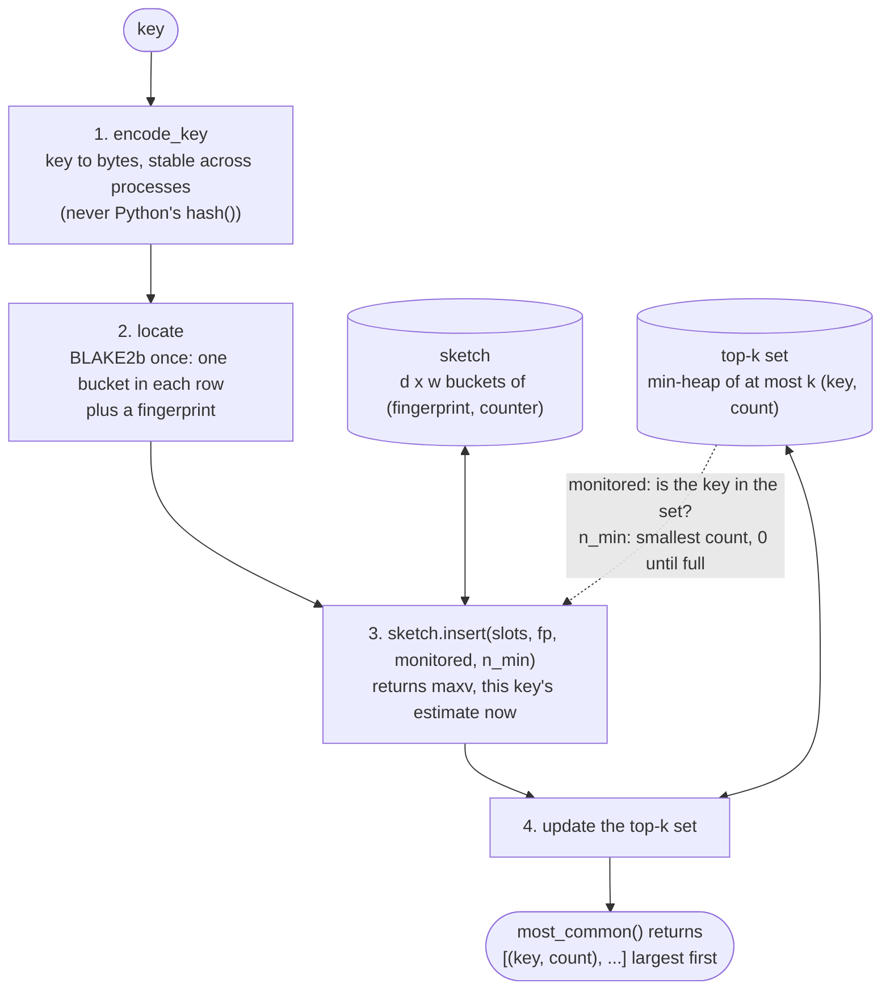
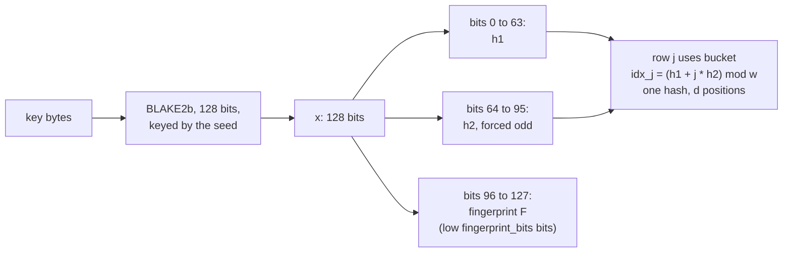
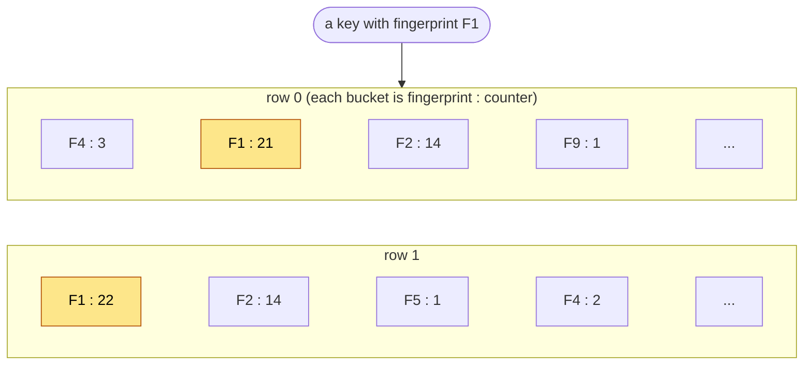
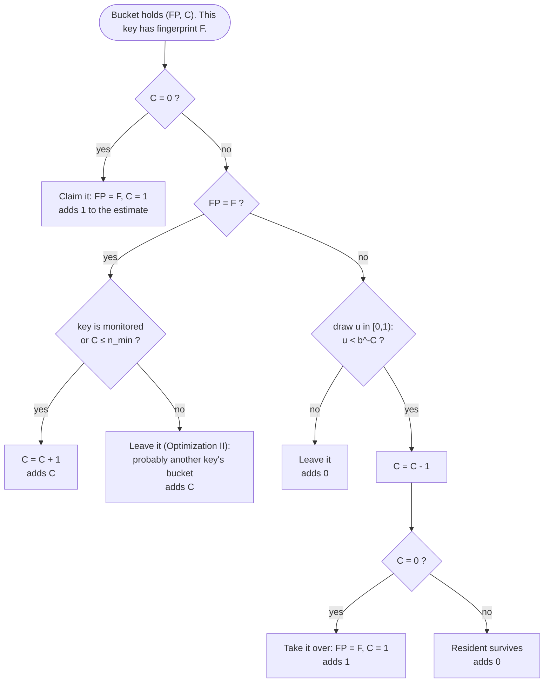
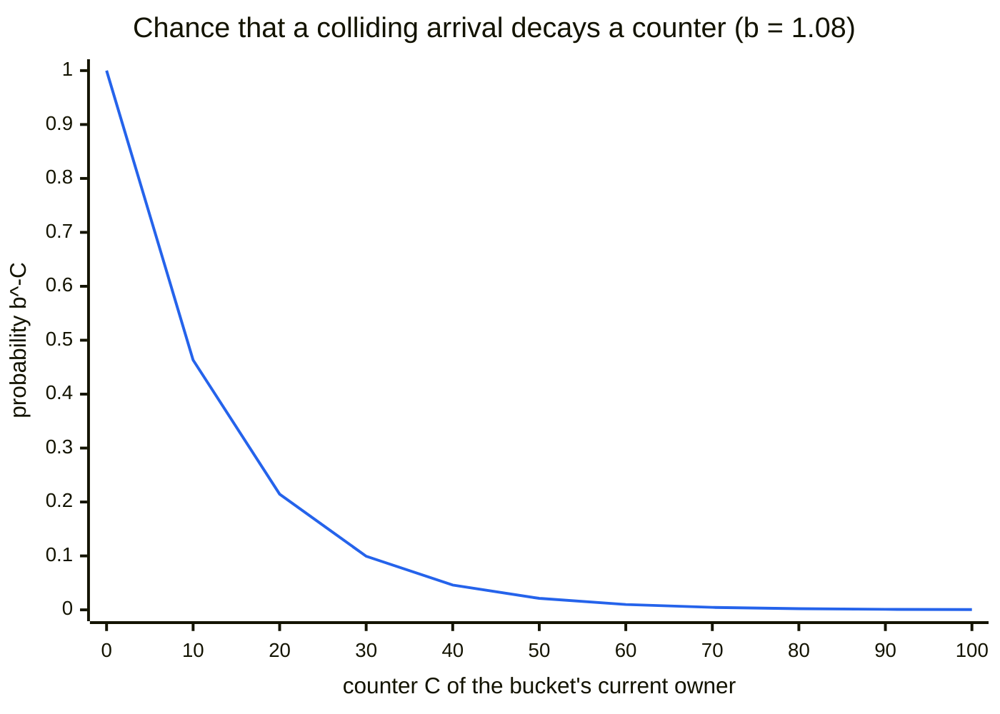
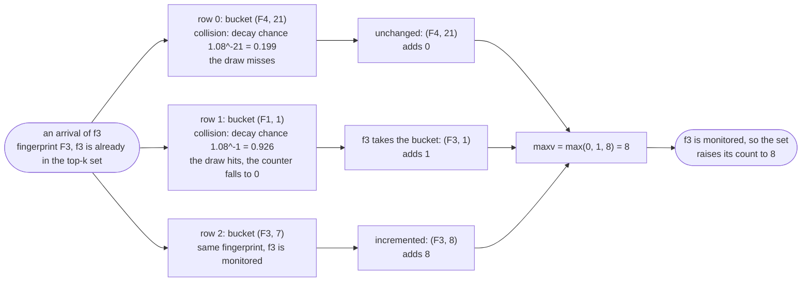
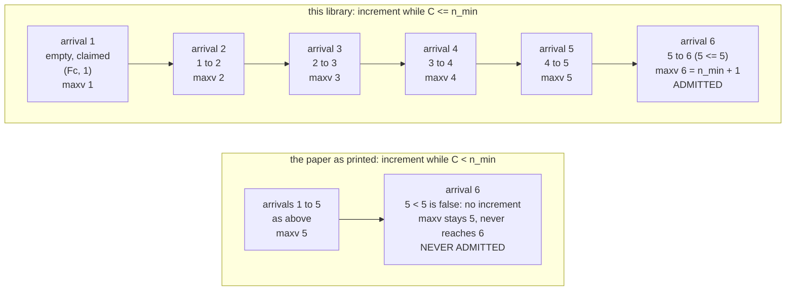
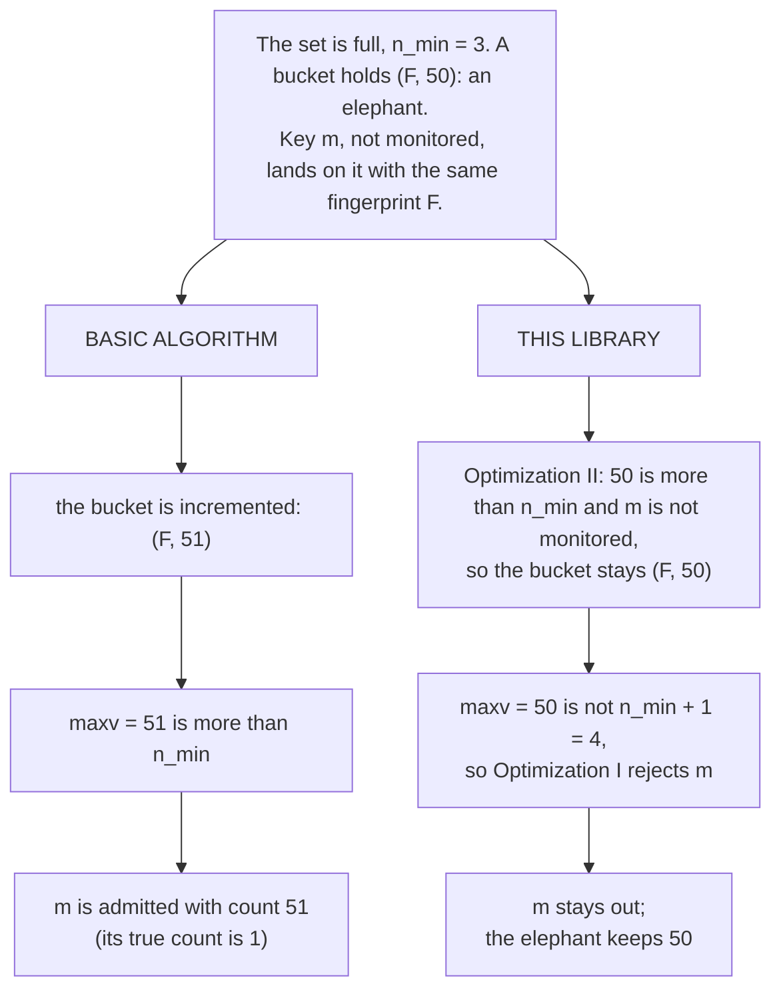

# How HeavyKeeper works

This page explains the algorithm with diagrams, in the order the data flows. The worked examples
(sections 3, 5, 7 and 8) are replayed through the real code by the `>>>` examples on this page,
which the test suite runs, and a test checks the decay chart's data against the library. The bucket
grid in section 2 is only an illustration. The examples reach into private classes
(`topk._sketch.PySketch`) to stage scenarios; that is for explanation only and is not public API.

## In plain words

The problem: keep the `k` most frequent keys of a stream that may hold millions of distinct keys,
in memory that does not grow. A `Counter` needs one entry per distinct key.

Picture a notice board with a fixed number of slots and a crowd of people each calling out a word.
Whenever a word is called, it goes to a slot chosen from the word itself. If the slot already shows
that word, its tally goes up by one. If the slot shows a *different* word, that other word's tally
may be knocked down by one, but only sometimes, and the bigger the tally the less likely it is. A
word called once or twice is soon wiped out; a word called thousands of times is practically
permanent. In the end the biggest tallies on the board belong to the most frequent words.

The board is the **sketch**. Because a slot only remembers a short stamp of the word (not the word),
a second, small structure, the **top-k set**, keeps the names of the `k` words that currently have
the biggest tallies, so they can be reported by name. The rest of this page makes that precise.

**Vocabulary.** A *key* is one of the things you count (the paper calls it a *flow*), and an
*arrival* is one occurrence of a key in the stream (the paper says *packet*). A frequent key is an
*elephant* and a rare one a *mouse*. A key is *monitored* when it is currently in the top-k set. `k`
is how many keys you want, `d` (`depth`) the number of rows of the sketch and `w` (`width`) the
number of buckets per row. `b` is `decay_base`. `n_min` is the smallest count in the top-k set.

## 1. One `add()` from end to end



Steps 3 and 4 are the algorithm; sections 3 to 8 take them apart. `add(key, count)` runs steps 3
and 4 `count` times but steps 1 and 2 only once.

## 2. The sketch: buckets and hashing

The sketch is `d` rows of `w` buckets. Each bucket holds a **fingerprint** (a few bits of the key's
hash, used to tell keys apart without storing them) and a **counter**. A key maps to exactly one
bucket in each row, and all `d` positions come from a single hash of the key:



A bucket is a (fingerprint, counter) pair, 4 + 8 = 12 bytes. This picture is an illustration (the
values are made up): a key with fingerprint `F1` lands on the highlighted bucket of each row:



The buckets are stored flat, as `fps[j * w + idx]` and `counts[j * w + idx]`, in two compact
`array` objects.

Many keys share every bucket, so a bucket cannot tell which key its counter belongs to. The
fingerprint says which key *last claimed* it, and the rules below keep the counter honest about
that key. The sketch never stores a key, only a fingerprint, which is why its size is fixed.

## 3. Inserting into a bucket

For each of its `d` buckets, a key follows one of three rules, depending on what the bucket holds.
Each bucket then contributes a number to the key's estimate (the diagram calls it "adds"), and the
estimate `maxv` that comes back is the largest of the `d` contributions.



- **Empty bucket:** claim it.
- **Same fingerprint:** it is (almost certainly) this key's own bucket, so count the occurrence.
  The right-hand condition is Optimization II, explained in section 8.
- **Different fingerprint (a collision):** another key owns the bucket. With probability `b^-C` the
  resident's counter loses one; if that reaches zero the newcomer takes the bucket over. Otherwise
  nothing changes. This decay is the heart of the algorithm; section 4 shows why it works.

The three outcomes of a collision, replayed through the real kernel with a scripted random draw
(`C = 5` gives `b^-C = 0.68`):

```pycon
>>> import random
>>> from array import array
>>> from topk import TopK
>>> from topk._sketch import PySketch
>>> class Script(random.Random):
...     """A Random that replays chosen draws (one is taken per collision)."""
...
...     def __new__(cls, *draws):
...         return super().__new__(cls)
...
...     def __init__(self, *draws):
...         super().__init__(0)
...         self.draws = list(draws)
...
...     def random(self):
...         return self.draws.pop(0)
>>> def collide(counter, draw):
...     """Insert key "a" where another key's fingerprint holds `counter`."""
...     sketch = PySketch(1, 1, 1.08, 32, 7, rng=Script(draw))
...     slots, fp = sketch.locate(b"a")
...     sketch.fps[0] = (fp + 1) % 2**32  # a different fingerprint
...     sketch.counts[0] = counter
...     adds = sketch.insert(slots, fp, True, 0)
...     return adds, sketch.counts[0], sketch.fps[0] == fp
>>> collide(counter=5, draw=0.99)  # u >= b^-C: nothing happens
(0, 5, False)
>>> collide(counter=5, draw=0.0)  # u < b^-C: the resident loses one and survives
(0, 4, False)
>>> collide(counter=1, draw=0.0)  # the resident reaches 0: the newcomer takes the bucket
(1, 1, True)
```

## 4. Why decay separates mice from elephants

A mouse's bucket holds a small counter, so a colliding arrival decays it almost every time and the
mouse is gone after a few arrivals. An elephant's counter is large, so decay is rare. With
`b = 1.08`:



Read it as: a counter of 1 is knocked down almost every time a different key collides with it
(0.93); a counter of 50 only about one time in 47; a counter of 100 about one time in 2,200. From
`C = 478` on, `b^-C` is below `2^-53` and no random draw is taken at all. The numbers behind the
chart, and how many colliding arrivals it takes on average to remove one count:

```pycon
>>> b = 1.08
>>> for c in (1, 5, 10, 20, 50, 100, 200):
...     print(f"{c:>4}  {b**-c:<10.3g}  {b**c:>12,.1f}")
   1  0.926             1.1
   5  0.681             1.5
  10  0.463             2.2
  20  0.215             4.7
  50  0.0213           46.9
 100  0.000455       2,199.8
 200  2.07e-07   4,838,949.6
>>> PySketch(1, 1, 1.08, 32, 1).decay_cutoff
478
```

So an elephant that has built up a counter keeps it through a flood of colliding mice, while a
mouse that wandered into an elephant's bucket cannot dislodge it. A larger `decay_base` makes small
counters fade faster; the paper uses 1.08.

## 5. Worked example: the paper's Figure 1

An arrival of key `f3` (fingerprint `F3`), which is already in the top-k set: It maps to one
bucket in each of three rows:



The same walk through the kernel, with the draws scripted as 0.5 (above `0.199`, so no decay) and
0.0 (below `0.926`, so decay):

```pycon
>>> sketch = PySketch(
...     width=1, depth=3, decay_base=1.08, fingerprint_bits=32, seed=7, rng=Script(0.5, 0.0)
... )
>>> slots, f3 = sketch.locate(b"f3")
>>> sketch.fps[:] = array("I", [f3 + 1, f3 + 2, f3])  # F4, F1, F3
>>> sketch.counts[:] = array("Q", [21, 1, 7])
>>> sketch.insert(slots, f3, True, 0)  # maxv
8
>>> list(sketch.counts)
[21, 1, 8]
>>> [fp == f3 for fp in sketch.fps]  # f3 now owns rows 1 and 2
[False, True, True]
>>> round(sketch.decay_probability(21), 3), round(sketch.decay_probability(1), 3)  # as in the diagram
(0.199, 0.926)
```

Each key is stored in `d` buckets, and the estimate is the largest of its counters. Using several
rows guards against the unlucky case where one of a key's buckets is a poor home (for example it
was taken over, as in row 1 here): another row will usually still hold a good count.

## 6. The top-k set

The sketch only produces an estimate. A second structure, a min-heap of at most `k` keys with
their counts, decides who is in the top `k`. After each insertion the set looks at `maxv`:


**Why a full set admits only at exactly `n_min + 1` (Optimization I).** A newcomer must beat the
smallest entry, so `maxv` below `n_min + 1` is rejected. But a genuine newcomer's counter climbs by
one per arrival, and only while it is `≤ n_min` (Optimization II), so it can only ever arrive at
exactly `n_min + 1`. A larger value cannot come from a genuine newcomer: it means the key landed on
another key's bucket through a fingerprint collision (the paper's Theorem 1). Rejecting it makes
it much harder for a mouse to borrow an elephant's count.

## 7. A newcomer climbs into a full set

Here `k = 2`, the set holds `{a: 5, b: 5}` (so `n_min = 5`), and a new key `c` arrives six times
with no collisions:



The paper prints the test as `C < n_min`. With that strict comparison arrival 6 would not
increment (5 < 5 is false), `maxv` would stay at 5, and `c` would never be admitted however often it
appears. The authors' code, and this library, use `C <= n_min`.

```pycon
>>> top = TopK(2, width=4096, seed=1)
>>> top.add("a", 5)
>>> top.add("b", 5)
>>> for arrival in range(1, 7):
...     top.add("c")
...     print(arrival, top.estimate("c"), "c" in top)
1 1 False
2 2 False
3 3 False
4 4 False
5 5 False
6 6 True
```

## 8. Fingerprint collisions, and why the two optimizations exist

Two different keys that land in the same bucket *and* have the same fingerprint look identical to
that bucket, and the sketch cannot tell them apart. Given two keys in one bucket, the chance that
their fingerprints match is 1 in 2^bits: about one in four billion with the default 32-bit
fingerprints, one in 256 with 8-bit ones. (Across a whole stream some pair of keys will share a
fingerprint somewhere: with 100,000 distinct keys it is more likely than not. That matters only if
the pair also shares a bucket.) With short fingerprints the problem is common, which is where the
optimizations earn their keep:



Measured with 8-bit fingerprints on a 500,000-item Zipf stream, `k = 100`:

| | precision | ARE (average relative error) |
|---|---|---|
| basic algorithm | 0.75 to 0.82 | 385 to 800 |
| this library | 0.99 to 1.00 | about 0.005 |

With 32-bit fingerprints the two give identical results.

Staging that collision (this pokes at private state to set the scene):

```pycon
>>> def collision(cls):
...     """A full set (n_min = 3) and a bucket holding an elephant (50) under m's fingerprint."""
...     tk = cls(2, width=1, depth=1, seed=1)
...     tk._heap.push("b", 3)
...     tk._heap.push("c", 3)
...     slots, fp = tk._sketch.locate(tk._encode("m"))
...     tk._sketch.fps[slots[0]] = fp
...     tk._sketch.counts[slots[0]] = 50
...     return tk
>>> class Basic(TopK):  # the plain algorithm, without Optimizations I and II
...     _selective_increment = False
...     _exact_admission = False
>>> full = collision(TopK)
>>> full.add("m")
>>> "m" in full, full._sketch.counts[0]  # rejected, and the elephant's count is untouched
(False, 50)
>>> basic = collision(Basic)
>>> basic.add("m")
>>> ("m", 51) in basic.most_common()  # a mouse reported at 51 after one arrival
True
```

## Where to go next

- The README covers the API, parameters (`width`, `depth`, `decay_base`, `fingerprint_bits`),
  memory, and the measured accuracy and speed.
- [docs/examples.md](examples.md) has runnable examples and recipes.
- The paper: Gong et al., *HeavyKeeper: An Accurate Algorithm for Finding Top-k Elephant Flows*,
  USENIX ATC 2018, <https://www.usenix.org/conference/atc18/presentation/gong>. Section 3 is the
  algorithm and its optimizations; Section 4 proves the no-overestimation and error bounds.
- The README's "Differences from the paper" lists where this implementation deliberately departs
  from the paper's pseudocode, including the `C < n_min` typo shown in section 7.
