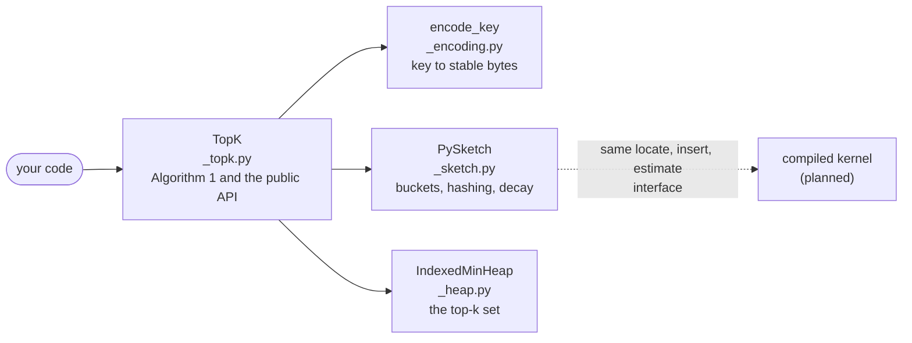

# Design notes: a pure-Python HeavyKeeper library

These notes describe how the library is built and why. They are written for people who want to
change the code. To *use* the library, read the [README](../../../README.md); to understand the
algorithm, read [How HeavyKeeper works](../../algorithm.md).

## Summary

`heavykeeper-topk` finds the `k` most frequent items of a stream in fixed memory. It implements
HeavyKeeper (Gong et al., USENIX ATC 2018) in pure Python, including the paper's two accuracy
refinements (Optimizations I and II). The package is imported as `topk`.

The strategy is **pure Python now, a compiled backend later**: ship a dependency-free reference
implementation first, and keep the interface between the pieces narrow enough that a compiled
kernel can replace the slow part without changing the public API.

## Status

| Area | State |
|---|---|
| Library (`TopK`, key encoding, sketch, heap) | Done and merged |
| Tests: unit, property-based, accuracy gates, microbenchmarks | Done and merged |
| Benchmarks and measurements | Done and merged |
| README, algorithm guide, examples guide, runnable examples | Done |
| CI on CPython 3.10 to 3.14 (Linux, macOS, Windows) and PyPy 3.11 | Done |
| Release workflow and maintainer guide | Done (see [Releasing](#releasing)) |
| First publication to PyPI | **Not done**: needs the maintainer's PyPI accounts |
| Compiled backend, other uses from the paper | Later (see [Roadmap](#roadmap)) |

## Why a new library

A survey of existing implementations, done before building, found:

- The only Python package, [`heavykeeper`](https://pypi.org/project/heavykeeper/) on PyPI, is a thin
  wrapper over a Rust crate. It takes `str` keys only, does not expose pickling, has few users, and
  implements the basic algorithm: neither refinement from the paper.
- [Redis `TOPK`](https://redis.io/docs/stack/bloom/TopK_Commands) also implements the basic
  algorithm, and needs a Redis server.
- There are implementations in Go, Rust, Java, Ruby and C++, and none in pure Python.

That leaves room for a library that is pure Python, accepts any hashable key, includes both
refinements, can be pickled and is fully typed. The refinements matter: with short fingerprints
they separate a usable result from a useless one (see the README's benchmarks).

## Goals and non-goals

**Goals:** bounded memory; accuracy at least as good as the paper reports; any hashable key; a small
public API; no runtime dependencies; correctness that tests can pin down.

**Non-goals for 0.1:** speed (pure Python is about 20 times slower than a Rust implementation, and
that is accepted); sliding windows; merging sketches; thread safety.

## Architecture

| Module | Responsibility |
|---|---|
| `topk._topk.TopK` | The public class. Runs Algorithm 1: encode the key, ask the sketch, update the top-k set. Validates arguments and handles pickling. |
| `topk._encoding` | `encode_key(key) -> bytes`: a stable, collision-free byte encoding of keys. |
| `topk._sketch.PySketch` | The bucket arrays. Hashing (`locate`), the insert rule (`insert`) and the query (`estimate`). Knows nothing about the top-k set. |
| `topk._heap.IndexedMinHeap` | A min-heap with a dictionary from key to position: the top-k set. |

Everything with a leading underscore is private. The only public name is `topk.TopK`.

Other directories: `tests/` (the test suite), `benchmarks/` (accuracy and speed scripts),
`examples/` (runnable scripts), `docs/` (the guides) and `.github/workflows/ci.yml` (CI).

### The kernel interface

The sketch has exactly three operations, so a compiled kernel can replace it:

- `locate(data) -> (slots, fingerprint)` hashes an encoded key once.
- `insert(slots, fingerprint, monitored, n_min) -> maxv` counts one occurrence and returns the key's
  estimate.
- `estimate(slots, fingerprint) -> int` asks for the current estimate.

Hashing is split from inserting so that `add(key, count)` hashes once and then inserts `count`
times. A future native kernel would implement the same three operations and be chosen at import
time, falling back to the Python kernel. Pickled state records a hashing-scheme identifier, so
loading a sketch written by an incompatible kernel fails with an error instead of giving wrong
answers. The native code would ship as a separate distribution behind an extra, so the main wheel
stays pure Python.

## Key decisions

**Keys are encoded to bytes and hashed with keyed BLAKE2b, never with `hash()`.** Python randomizes
the hash of `str` and `bytes` per process, so a pickled sketch loaded in another process would map
keys to different counters and silently return nonsense. The encoding is prefix-free (so different
keys give different bytes) and consistent with `==` (so `True` and `1` encode alike). Its format and
the hash scheme are pinned by tests, because saved state depends on them.

**A key subclass is accepted only if it inherits `__eq__` and `__hash__` unchanged,** and the
encoding is computed with the builtins' own methods. Otherwise a subclass that redefines equality
could make two different dictionary keys share an encoding. Such keys need an explicit
`key_encoder`.

**Optimization II compares `c <= n_min`, not `c < n_min`.** The paper's pseudocode prints the strict
form, which would stop a new frequent key from ever reaching `n_min + 1` and entering a full set.
The authors' own code uses `<=`. A regression test reproduces the problem through the public API.

**`n_min` is 0 until the top-k set is full,** as in the authors' code. A key whose estimate is 0 is
never admitted.

**Buckets live in `array.array`, not lists.** Measured on a 500,000-item stream: the same insert
speed (312k against 313k per second) and 3.7 times less memory, because a list stores every 32-bit
fingerprint as a separate 28-byte object. A bucket costs 12 bytes (4 for the fingerprint, 8 for the
counter).

**The default fingerprint is 32 bits** (the paper used 16). Two keys that share a bucket then match
on fingerprint about once in four billion times, against once in 256 with 8 bits. (Some pair of keys
in a large stream will share a fingerprint, but that only matters if the pair also shares a bucket.)
The optimizations gave results identical to the basic algorithm at 32 bits in the tests and are
decisive at 8 bits, so the accuracy tests that distinguish them run with 8-bit fingerprints.

**The default `width` is `max(1024, 32 * k)`.** Measured on a 500,000-item Zipf stream with `k =
100`: precision 1.000 and average relative error below 0.0008 on every seed, so no tuning was
needed.

**The decay probability is exactly `b ** -C`,** read from a table up to 4,096 entries and computed
beyond that. From the count where `b ** -C` falls below 2^-53 a counter is never decayed and no
random number is drawn. The cutoff is computed against the actual powers, because the logarithm
formula is off by one for some bases (a bug found in review).

**The random generator is injectable.** Tests script exactly which bucket decays, which is how the
paper's Figure 1 example is reproduced.

**Integer arguments go through `operator.index`.** Otherwise `TopK(float("nan"))` would build a set
that is never full, quietly breaking the memory bound.

**The basic algorithm is two class attributes away.** `_selective_increment` and `_exact_admission`
(both `True`) switch Optimizations II and I off. The benchmarks and the tests use them to show what
each optimization changes. They are private.

**State is versioned, and the docs warn about trust.** A `TopK` pickles with a version number, and
an incompatible version raises `ValueError`. Because `pickle.loads` can run code before that
check, the documentation says to load checkpoints only from trusted storage.

**Names.** The distribution is `heavykeeper-topk` and the import is `topk`. The shorter distribution
name `topk` cannot be registered: PyPI treats names that differ only by `.`, `_`, `-`, `l`/`i` and
`o`/`0` as the same, and `topk` collides with the existing `top-k`. The import name is free.

## How it is tested

- **Unit and property-based tests** (Hypothesis): key encoding is injective and agrees with `==`
  (including surrogate characters); the heap is checked against a plain dictionary after every
  operation by a state machine; the sketch never overestimates (the paper's Theorem 2), over random
  streams, widths and optimization inputs.
- **Golden values** pin the key-encoding format and the hash scheme, so a change that would break
  saved state fails a test.
- **Scenario tests with a scripted random generator** reproduce each insert case and the paper's
  Figure 1; further tests stage a fingerprint collision to show what each optimization changes.
- **Accuracy gates** (`pytest -m slow`, about 15 seconds): precision, relative error and the
  difference between the full and basic algorithms on a 500,000-item Zipf stream.
- **Microbenchmarks** (`pytest -m bench`): 14 `pytest-benchmark` tests, each also checking that what
  it timed behaved correctly. CI keeps the results as an artifact but does not fail on speed, since
  shared runners are too noisy for a threshold.
- **Documentation tests:** every `>>>` example in the README, the algorithm guide and the examples
  guide is run, the example scripts are run, the Mermaid diagrams are checked for structure, and the
  decay chart's data is checked against the library.
- During development, the important behaviors were also checked by breaking the code on purpose
  (for example reintroducing the paper's strict comparison) and confirming a test fails. That was
  done by hand; it is not automated.

CI runs lint (`ruff`), strict type checking (`mypy`), the test suite on CPython 3.10 to 3.14 on
Linux, macOS and Windows and on PyPy 3.11, the accuracy gates, the microbenchmarks, and a build with
`twine check`.

## Measurements

On one machine, CPython 3.13, a 500,000-item Zipf stream with skew 1.1 and `k = 100`:

- Defaults: precision 1.000, average relative error 0.0005 to 0.0008.
- Memory: 12 bytes per bucket (24.6 KB at the defaults) plus about 84 bytes per tracked key.
- Speed: about 0.3 million inserts per second. The Rust-backed `heavykeeper` package does about 6
  million at similar accuracy.

The README has the full table, including the 8-bit fingerprint runs.

## Releasing

The release workflow (`.github/workflows/release.yml`) exists. On a `v*` tag it checks that the tag
matches the version in `pyproject.toml`, builds the sdist and wheel, runs `twine check`, installs the
built wheel on Linux, macOS, Windows and PyPy and runs a small program with it, and then publishes
through PyPI Trusted Publishing, so no token is stored. Run by hand it does a dry run to TestPyPI.
The tag check is a small tested script, and tests pin the workflow's security-relevant structure.

The workflow has not published anything yet. What is left:

1. **Steps only the maintainer can do:** create the PyPI and TestPyPI accounts, register a pending
   trusted publisher on each for `heavykeeper-topk`, and create the `pypi` and `testpypi`
   environments on GitHub. [docs/releasing.md](../../releasing.md) has the exact values.
2. Run the TestPyPI dry run, install the result into a clean virtual environment, then release
   0.1.0: change the version from `0.1.0.dev0`, date the changelog entry, and push the tag.

## Roadmap

Each of these would get its own design before work starts:

- A compiled kernel (probably Rust with PyO3 and maturin), behind a `[fast]` extra.
- The paper's other uses (section 3.6): a heavy-hitter query (everything above a fraction of the
  stream) and heavy-change detection between two time bins.
- The paper's Optimization III, which replaces the heap with a threshold array.
- Sliding windows and merging two sketches.

## How it was built

The work went in small steps, each driven by a failing test first, and each reviewed as a pull
request.

| Step | What it added |
|---|---|
| 1 | Project scaffolding: packaging, lint, type checking, CI |
| 2 | Key encoding and the indexed min-heap |
| 3 | The sketch kernel: hashing, decay, the insert rule |
| 4 | The `TopK` class: Algorithm 1 with both refinements, validation, pickling |
| 5 | Compact bucket storage, the benchmark scripts and the accuracy gates |
| 6 | README, the examples guide, runnable examples, microbenchmarks |
| 7 | The algorithm guide with diagrams, and a readability pass over all documentation |
| 8 | The release workflow and the maintainer guide |
